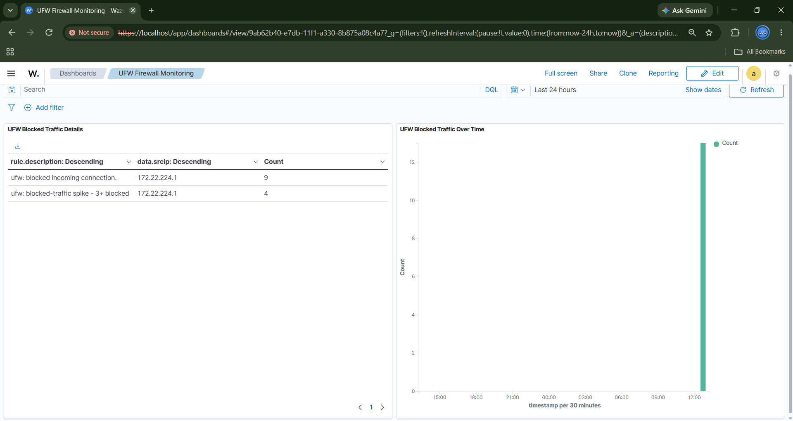

# Wazuh Home SOC Lab

A self-built, hands-on SIEM lab using [Wazuh](https://wazuh.com/) to demonstrate practical security monitoring, detection engineering, and incident response — built while studying for entry-level cybersecurity roles alongside a Check Point CCSA R82 certification.

**All testing in this repo was performed against infrastructure I own (my own laptop and virtual machines) that I was explicitly authorized to test. No external systems were accessed or scanned.**

## What this demonstrates

- Deploying and hardening a Wazuh SIEM stack (Docker), including changing default credentials and binding management ports to localhost only
- Enrolling multiple endpoints (Windows + Linux) as monitored agents
- Simulating a real SSH brute-force attack (Hydra) against a controlled test account and analyzing how Wazuh's default ruleset detects it
- **Detection engineering**: writing, debugging, and validating two custom correlation rules from scratch — including finding and fixing a case where a rule silently failed to fire due to a rule-chaining assumption that didn't hold in this Wazuh version, and a separate case where Wazuh's built-in `ufw` decoder didn't match this system's actual log format at all
- Mapping real alerts to [MITRE ATT&CK](https://attack.mitre.org/) techniques (T1110.001, T1078, T1021, T1046)
- Building a monitoring dashboard (OpenSearch Dashboards) to visualize blocked-traffic activity
- Writing an incident report in a standard detect → triage → contain → lessons-learned format

See [`docs/incident-report-ssh-bruteforce.md`](docs/incident-report-ssh-bruteforce.md) for the full writeup of one simulated incident, and [`docs/architecture.md`](docs/architecture.md) for how the lab is wired together.

## Dashboard

A custom dashboard built in OpenSearch Dashboards, showing the two custom detection rules firing on a live test attack — a data table (rule description, source IP, count) alongside a time-series chart pinpointing exactly when the attack occurred:

## What's in this repo

| Path | What it is |
|---|---|
| `rules/local_rules.xml` | Custom Wazuh detection rules — SSH brute-force correlation and ufw blocked-traffic-spike correlation |
| `decoders/local_decoder.xml` | Custom log decoder for ufw firewall logs on Ubuntu/WSL2 (the stock Wazuh decoder doesn't match this platform's log format) |
| `docs/incident-report-ssh-bruteforce.md` | One-page mock incident report for the SSH brute-force test |
| `docs/architecture.md` | Lab architecture and data flow |

## Lab setup (summary)

- **SIEM:** Wazuh v4.14.10, single-node Docker deployment ([official wazuh-docker](https://github.com/wazuh/wazuh-docker))
- **Agents:** Windows 11 (native agent), Ubuntu 26.04 LTS running in WSL2 (apt-installed agent)
- **Attack simulation:** [Hydra](https://github.com/vanhauser-thc/thc-hydra) v9.6 against a throwaway, lab-only test account
- **Firewall:** `ufw` on the Ubuntu agent, with a deny rule and per-rule logging

To reproduce: follow the official Wazuh Docker deployment guide, then copy `rules/local_rules.xml` into the manager's `etc/rules/` directory and `decoders/local_decoder.xml` into `etc/decoders/`, and restart the manager (`wazuh-control restart`) to load them.

## Key debugging findings (the useful part)

1. **A correlation rule can be loaded and syntactically valid, and still never fire.** My first SSH brute-force rule used `if_matched_sid` pointing at a parent rule ID; the manager's rule engine only counted the *exact* rule ID that actually fired the alert (a child rule), not its ancestor. Confirmed via the Wazuh API (`GET /rules?rule_ids=`) that the rule *was* loaded, then isolated the fix with a controlled test.
2. **ufw's logging level matters a lot, and the default is misleading.** At the default logging level, ufw does *not* log traffic blocked by rules you add yourself — only traffic hitting the final default-deny policy. Raising logging to "high" logs everything (very noisy, and tags it as generic `AUDIT` rather than `BLOCK`). The correct fix is per-rule logging (`ufw deny log <port>`).
3. **Wazuh's built-in `ufw` decoder assumes a specific log format that doesn't match every system.** It expects a leading kernel-uptime bracket (`[ 1234.56]`) before `[UFW BLOCK]`, which this system's journald doesn't produce. Verified the mismatch directly with `wazuh-logtest`, then wrote a decoder matching the actual format.

## Certifications

- Check Point Certified Security Administrator (CCSA R82)

## Author

Bharath G — [github.com/bharathg2004](https://github.com/bharathg2004) — [linkedin.com/in/bharathg2004](https://linkedin.com/in/bharathg2004)
