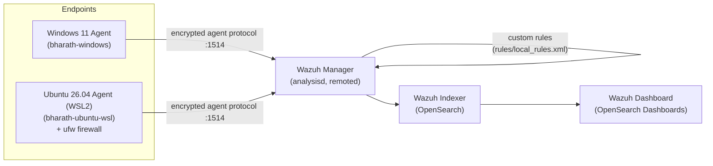

# Lab Architecture

## Overview

## Components

| Component | Role |
|---|---|
| **Wazuh Manager** | Receives agent events, decodes raw log lines into structured fields, matches them against the ruleset, and generates alerts |
| **Wazuh Indexer** | Stores alerts and makes them searchable (OpenSearch under the hood) |
| **Wazuh Dashboard** | Web UI for browsing alerts, building visualizations and dashboards |
| **Windows Agent** | Monitors Windows event logs (logins, process activity, file integrity) |
| **Ubuntu Agent (WSL2)** | Monitors journald logs, including SSH authentication and ufw firewall decisions |

## Security hardening applied

- Default `admin` password for the indexer/dashboard changed via Wazuh's documented hash-and-apply procedure (never done through the GUI alone, since that only changes the password for the GUI session and not the underlying manager/dashboard service accounts)
- Management ports (dashboard `443`, indexer API `9200`, manager API `55000`) bound to `127.0.0.1` only in `docker-compose.yml`, so nothing outside the host machine can reach them
- Attack simulation strictly scoped to a throwaway local test account and the lab's own loopback/WSL network — never directed at any external host

## Data flow for a detected event (example: SSH brute force)

1. An SSH login attempt fails on the Ubuntu agent's machine
2. `journald` captures the event
3. The Wazuh agent (via its journald log collector) forwards the raw log line to the manager
4. The manager's decoder pipeline extracts structured fields (source IP, username, etc.)
5. The ruleset matches the decoded event against rule conditions; a single failure fires a level-5 alert
6. If 3+ failures occur from the same source within 2 minutes, a custom correlation rule (`100010`) fires a higher-severity alert
7. The alert is written to the indexer and becomes visible/searchable in the dashboard
